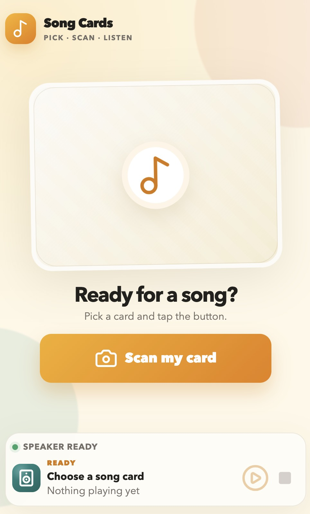
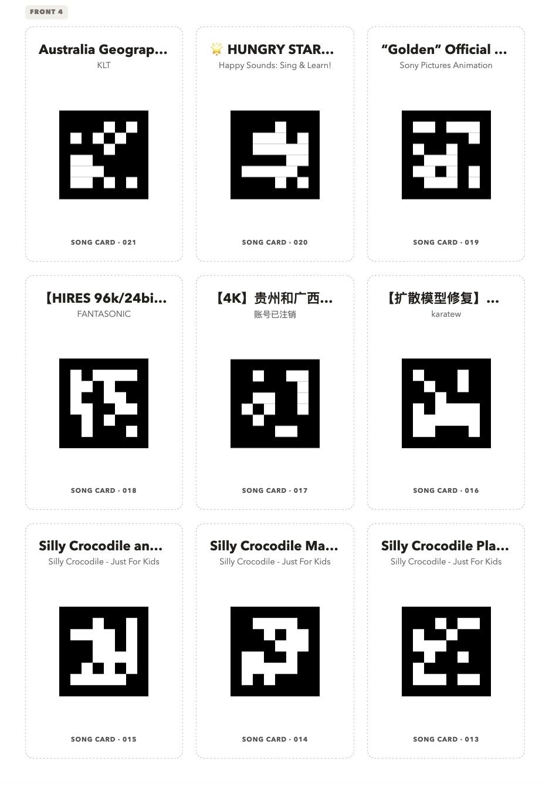
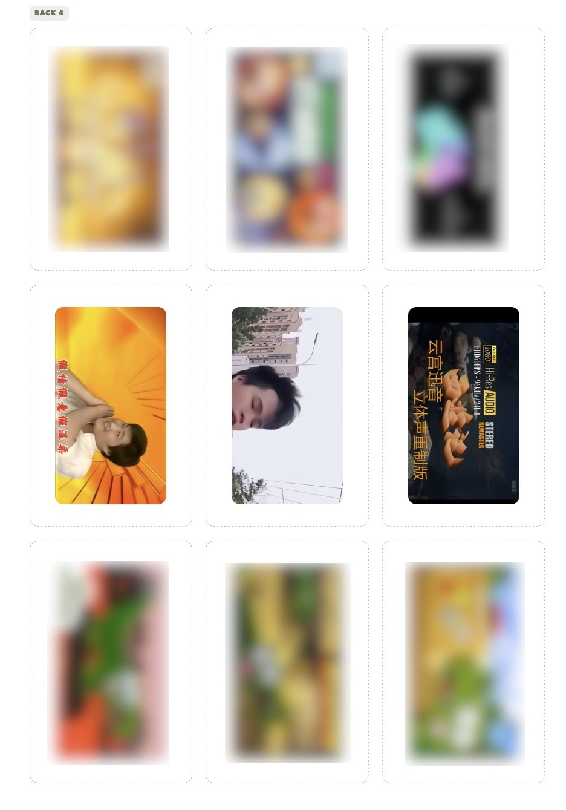
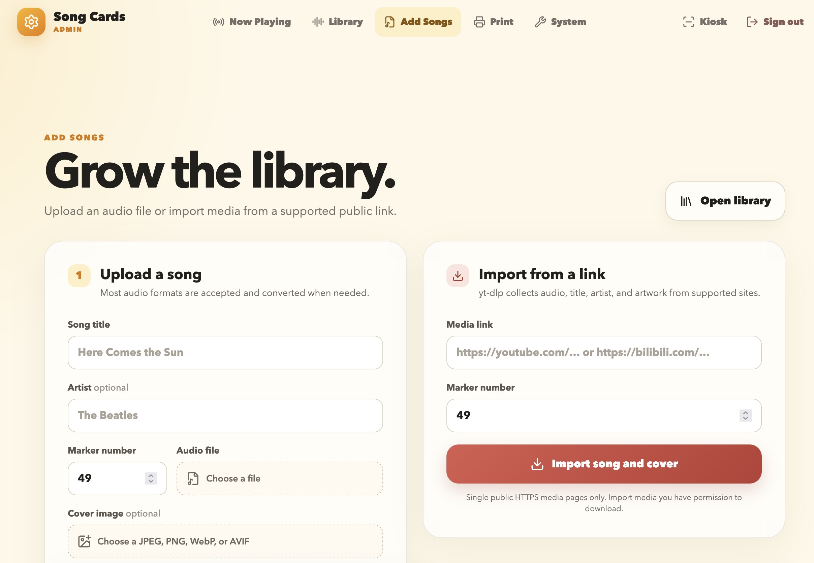

# Song Cards

Song Cards is a self-hosted, child-friendly music kiosk. A child scans a
printed ArUco card and its assigned song plays directly on the kiosk device.
An optional OwnTone integration can instead send every kiosk's scans to a
shared AirPlay speaker.

It is designed for a trusted home network, with a valid HTTPS reverse proxy so
mobile browsers can use the camera and install the kiosk as a Home Screen app.
The kiosk intentionally has no login; caregiver administration is password
protected.

## Interfaces

- `/` — redirects to the child-facing kiosk
- `/kiosk` — child-facing camera scanner and the installed Home Screen app
- `/admin/now-playing` — protected local and optional OwnTone controls
- `/admin/library` — protected browsing, playback, tuning, and song removal
- `/admin/add` — protected audio upload and link import
- `/admin/print` — protected printable card-sheet builder
- `/admin/system` — protected playback and yt-dlp settings/status

Install `/kiosk` as the child-facing app. Caregivers can bookmark the protected
`/admin` pages in their normal browser; those routes are intentionally not a
separate installed app.

The former `/play`, `/cards`, `/library`, `/remote`, `/control`, and
`/admin/songs` paths redirect to their current locations so existing bookmarks
continue to work.

Uploaded cover images are validated, resized, and stored as WebP files. They
appear after a successful scan and in both playback control interfaces.

## Screenshots

### Child-facing kiosk

The installed kiosk keeps the interaction focused: choose a card, tap once to
open the scanner, and the assigned song starts playing.



### Printable song cards

The marker fronts and matching cover backs are arranged for duplex printing.
After printing, cut along the guides and pair each marker with its cover image.

| Marker fronts | Cover backs |
| --- | --- |
|  |  |

### Add songs

Caregivers can upload an audio file and cover or import supported media from a
public link.



Audio uploads are inspected with FFprobe rather than trusted by filename or
browser MIME type. Known formats are preserved when possible; WebM, Opus,
video containers, and other decodable formats are normalized to M4A/AAC with
FFmpeg.

The administrator can also paste a public HTTPS URL supported by yt-dlp,
including YouTube and Bilibili. Song Cards imports one video's audio, title,
artist, and thumbnail as a background job. Playlists, local/private hosts, and
unauthenticated import requests are rejected. Only import media you own or
have permission to download.

New audio is measured with FFmpeg's EBU R128 analyzer. Song Cards keeps the
caregiver's master volume stable and applies a compensated volume for each
song. The targets and response curve can be adjusted under
`/admin/system`, while each song has a separate manual correction under
`/admin/library`. Existing libraries can be analyzed there with one button.

Start and end points are also stored as non-destructive song metadata. Local
and OwnTone playback both observe that window. An authenticated administrator
can set these points while listening; seek controls remain inside the configured
window.

Local-device playback streams the original stored audio through protected
byte-range endpoints. It applies the same automatic and manual loudness
correction and observes the same start/end metadata. Local state belongs to
that browser tab and the device's hardware volume remains an additional final
control.

The deployment-wide kiosk target is selected under **System** without adding
controls to the child-facing screen. With **Kiosk device** selected, the
**Scan my card** tap also unlocks iOS audio before opening the camera; a
successful scan then uses a short-lived signed audio URL and plays on whichever
device scanned the card.

The scanner uses the `ARUCO_MIP_36h12` dictionary, which provides 250 marker
identifiers. Deleting a song releases its marker number for reuse.

## Optional voice requests

Under **Admin → System → Ask for a song**, enter the full ASR transcription
endpoint and chat completions endpoint, their model names, and any API keys.
Both services use OpenAI-compatible HTTP APIs. These settings are stored in
SQLite; no deployment environment changes are required. Keys are stored in the
server database, never returned by the settings API, and should be included
only in private backups. Leaving a key field blank preserves its saved value;
use **Remove saved key** to clear it.

Voice requests and YouTube discovery are independently disabled by default.
Enable voice and reload the kiosk to show **Ask for a song**. The browser needs
microphone permission and trusted HTTPS (or localhost for development). It
pauses playback, detects the end of speech locally, and sends a recording of
up to 30 seconds to the configured ASR service. The VAD model and runtime are
served by Song Cards; kiosk devices do not load these from a CDN. They are
copied from dependencies by `predev` and `prebuild`.
While listening, tap **Tap again to recognize** to submit the recording immediately
without waiting for silence. The separate **×** button cancels recording or an
in-progress request.

A small agent receives the full available library (up to 250 card songs plus 20
cached downloads) as compact candidate IDs, titles, artists and durations. It can
select a local song in one model turn without a separate library search. The
transcript is explicitly identified as imperfect speech recognition: the model
should infer intended names, homophones and phonetic spellings, preferring a
convincing local pronunciation/name match. If none fits, online discovery uses
yt-dlp to search YouTube with likely corrected words before falling back to a
broadly related song. Up to 50 preferred channel IDs guide
discovery. The agent can use the `all` search scope when preferred results are
missing or unsuitable; the list is not an allowlist. All preferred channels are
considered when filtering global results, with a bounded rotating batch also
searched directly to keep requests quick.
Channel IDs use the `UC…` form rather than a channel display name or handle.
The **Song selection prompt** in System is editable. Use it to adjust related-song
choices and channel/language preferences; **Restore default prompt** resets it.
The default **Constrained JSON actions** response mode uses a strict JSON schema
instead of relying on the model server's native tool-call parser. **Native tool
calls** remains available for compatible endpoints. Arbitrary conversational
responses are never displayed as a no-play decision; those use fixed reason codes.
The selected video ID, channel and duration are checked again when downloading.
The agent gets four
model turns and at most three searches to select a returned result or explicitly
finish without playing. It can only choose IDs supplied in its library snapshot
or search results, never arbitrary playback URLs or commands.

Online selections are downloaded before playback. The 20 most recently used
voice downloads are retained in a separate cache and found by future local
searches. Each download is limited to 64 MiB and the configured duration limit.
Cached songs have no card number and do not appear in the printable card library.
Playback uses the deployment's existing kiosk-device or OwnTone target, including
loudness balancing. OwnTone must finish indexing new audio before it can play.
Already indexed selections reuse the library without triggering a rescan. New
files wait for OwnTone's library scan to finish before queue insertion; a visible
track alone does not mean OwnTone is ready to accept it. Playback is confirmed
against the selected track and player state, with one resume attempt if that
track remains paused.

One voice request runs at a time. Cancel, leave the kiosk, or start another card
scan to abandon it; late model results do not automatically start playback.
If the agent declines to play a song, playback resumes only when the same song
was playing before recording and is still paused. Previously paused songs stay
paused. Pausing an idle OwnTone speaker is a no-op, and a speaker pause failure
does not block microphone capture.
Recordings and transcripts are not retained by Song Cards. The configured
ASR and LLM services receive them and control their own retention. Job status
contains stage timings for diagnosing delays, and expires when the app restarts
or the bounded in-memory job history is pruned.

For troubleshooting, open **Admin → System → Ask for a song → Recent voice
activity**, reproduce the problem, then select **Refresh voice activity** and
**Copy diagnostics**. This shows the last 20 requests since the server started,
including microphone setup, transcription, selection, YouTube search/download,
audio processing, speaker indexing, and playback. Failed steps include a fixed
error code and an HTTP status when available. Desktop browser capture failures
also report their setup phase in the browser console under `[voice.capture]`.

The same server events appear with a `[voice]` prefix in **Portainer → Containers
→ your Song Cards container → Logs**, or with
`docker logs --since=10m --tail=200 <container-id>`. Docker Compose is not needed.
Older images do not emit these diagnostics, so an empty container log does not
mean that no requests reached the app. Recordings, transcripts, prompts, API keys,
and signed download URLs are excluded from these diagnostic records.

## Local development

Requirements:

- Node.js 24
- FFmpeg and FFprobe
- A current browser with camera access
- yt-dlp for testing YouTube imports outside Docker

```bash
cp .env.example .env
npm install
npm run dev
```

The development-only administrator password is `admin` when `ADMIN_PASSWORD`
is unset. Device-local playback is the default. Set `PLAYBACK_BACKEND=mock`
only when developing the external-player interface without OwnTone.

If yt-dlp is not on `PATH`, point the application to it with `YTDLP_PATH`.

Open:

```text
http://127.0.0.1:3000/
http://127.0.0.1:3000/admin/library
http://127.0.0.1:3000/admin/now-playing
http://127.0.0.1:3000/admin/add
```

`localhost` and `127.0.0.1` are accepted by browsers for camera development.
An iPad or another network device must access the app through a trusted HTTPS
reverse proxy.

## Linux deployment

Requirements:

- A Linux host with Docker Engine and Docker Compose
- A trusted local network
- A reverse proxy serving the app with a certificate trusted by kiosk devices

Copy `.env.example` to `.env`, set an administrator password of at least 12
characters and a random `SESSION_SECRET` of at least 32 characters, then start
the standalone app:

```bash
cp .env.example .env
docker compose pull app
docker compose up -d --no-build
docker compose ps
```

The app listens only on `127.0.0.1:3000`. A minimal Caddy site is:

```caddyfile
songs.example.com {
    reverse_proxy 127.0.0.1:3000
}
```

Configure local DNS so the kiosk resolves that name to the server. The reverse
proxy must preserve the original `Host` header and set the normal
`X-Forwarded-For`, `X-Forwarded-Host`, and `X-Forwarded-Proto` headers. Caddy
does this by default.

After signing in, add songs, print cards, and choose **Kiosk device** under
**Admin → System**. Open `/kiosk` on the playback device and install that page
to its Home Screen. OS-level Guided Access or app pinning is recommended for a
child-facing device.

### Optional OwnTone and AirPlay

To add shared-speaker playback, configure:

```dotenv
PLAYBACK_BACKEND=owntone
OWNTONE_URL=http://host.docker.internal:3689
OWNTONE_MEDIA_DIRECTORY=/srv/media
OWNTONE_OUTPUT_ID=
```

Start the app and OwnTone:

```bash
docker compose --profile airplay pull
docker compose --profile airplay up -d --no-build
docker compose ps
```

OwnTone uses host networking so Bonjour/mDNS can discover AirPlay receivers.
On first deployment, open OwnTone on port `3689`, select and pair the desired
AirPlay receiver, and copy its output ID into `OWNTONE_OUTPUT_ID`. The app
shares its media volume with OwnTone at `/srv/media`. Select **OwnTone speaker**
under **Admin → System** after it is connected.

The application image includes FFmpeg, FFprobe, Node as yt-dlp's JavaScript
runtime, and a checksum-verified official yt-dlp binary. The bundled binary is
copied into `/data/db/tools` and checks its configured update channel at most
once per day. Its version and manual update control are shown under the
YouTube import form.

Songs have no duration limit. The default audio size limit, import timeouts,
and updater behavior can be changed in `.env`:

```dotenv
MAX_UPLOAD_MB=2048
MAX_COVER_MB=10
YOUTUBE_IMPORT_TIMEOUT_SECONDS=600
YTDLP_AUTO_UPDATE=true
YTDLP_UPDATE_CHANNEL=stable
YTDLP_UPDATE_INTERVAL_HOURS=24
```

Loudness defaults can also be supplied through the environment. Once changed
in the System interface, the database values take precedence:

```dotenv
LOUDNESS_COMPENSATION_ENABLED=true
LOUDNESS_TARGET_LUFS=-16
LOUDNESS_SHORT_TERM_TARGET_LUFS=-13.5
VOLUME_CURVE_DIVISOR=74
KIOSK_PLAYBACK_TARGET=local
```

Use the `nightly` update channel temporarily when a YouTube change has not yet
reached yt-dlp's stable release. An update-check failure leaves the installed
binary in place. Some videos may still require authentication or
Proof-of-Origin token support, which Song Cards intentionally does not
configure.

Environment values are installation defaults. Once a value is saved in the
System interface, the SQLite setting takes precedence.

## Security model

The kiosk scanner and playback controls are intentionally unauthenticated so a
child can use them without accounts, codes, or device pairing. Treat the app
like an AirPlay receiver: deploy it only on a trusted LAN or behind a VPN. A
valid TLS certificate protects traffic but does not make a public deployment
private.

Administration pages and APIs use an expiring secure cookie. Production rejects
the example credentials, and repeated failed logins are temporarily throttled.
Do not expose port `3000` directly or publish Song Cards to the open internet.
See [SECURITY.md](SECURITY.md) for the supported security boundary and reporting
instructions.

## Data and upgrades

The `song-cards-db` volume contains SQLite state and tool updates. The
`song-cards-media` volume contains audio and covers. Back up both volumes
together while the app is stopped. Test restoration before relying on a backup.

For upgrades, back up both volumes, run `docker compose pull app`, then run
`docker compose up -d --no-build`. Pin `APP_IMAGE` to a `sha-<commit>` tag when
you need a reproducible deployment or rollback.

## Build and publish to GHCR

Every push to `main` runs linting, type checking, tests, and the production
build in GitHub Actions. After those checks pass, the workflow builds the
Docker image for AMD64 and ARM64 and publishes these tags:

- `ghcr.io/d1scolor/song-cards:latest`
- `ghcr.io/d1scolor/song-cards:sha-<full-commit-sha>`

Publishing uses the workflow's short-lived `GITHUB_TOKEN`; no personal access
token or local GHCR login is required. Forks publish under their own repository
name and should update `APP_IMAGE` accordingly. If an existing GHCR package was
created outside Actions, grant this repository write access under the package's
**Manage Actions access** setting before the first workflow run.

### Build and push directly from your workstation

With Docker Desktop/Engine running and `docker login ghcr.io` authenticated with
package write access, commit the changes and run:

```bash
npm run publish:image
```

This uses the local Buildx cache and pushes both `linux/amd64` and `linux/arm64`
under `latest` and `sha-<full-commit-sha>`. `IMAGE_NAME` overrides the registry
repository; `PLATFORMS` can select a deployment architecture. The Next.js build
runs once on the workstation architecture; runtime dependencies are installed
separately for each target architecture. This command does not depend on CI.

## Contributing and license

Contributions are welcome; see [CONTRIBUTING.md](CONTRIBUTING.md). Song Cards is
licensed under [GPL-3.0-only](LICENSE). Third-party software distributed with
the application is listed in [THIRD_PARTY_NOTICES.md](THIRD_PARTY_NOTICES.md).
